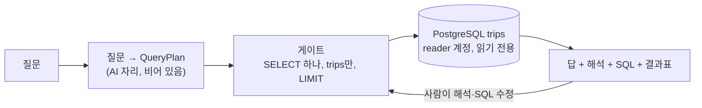

# 구조

## 흐름

## 전처리 후 테이블: trips

| 컬럼                  | 뜻                                       |
| --------------------- | ---------------------------------------- |
| date                  | 날짜 (2026-10-22 \~ 10-26)               |
| dow                   | 요일 (목, 금, 토, 일, 월)                |
| is_weekend            | 토·일이면 true                           |
| hour                  | 출발 시각의 시 (0 \~ 23)                 |
| slot                  | 5분 단위 시각 (HHMM)                     |
| start_id / end_id     | ST-xxxx                                  |
| start_dong / end_dong | 대여소명 앞부분 행정동. 이름이 비면 NULL |
| trips                 | 건수                                     |

- 출발 기준 행만 넣는다 (D-003)
- 이용 시간·거리 컬럼은 넣지 않는다 (D-007)

## AI 자리

비어 있다. v0.2에서는 템플릿 매칭이, v0.5에서는 모델이 이 자리를 채운다.
둘은 같은 시그니처 `to_query(question, schema) -> QueryPlan`을 따른다.

## 게이트

- SQL 문장은 하나, SELECT만
- 테이블은 trips만
- LIMIT 강제
- PostgreSQL reader 계정으로 연결 (week09 이중 게이트와 같은 구조)
